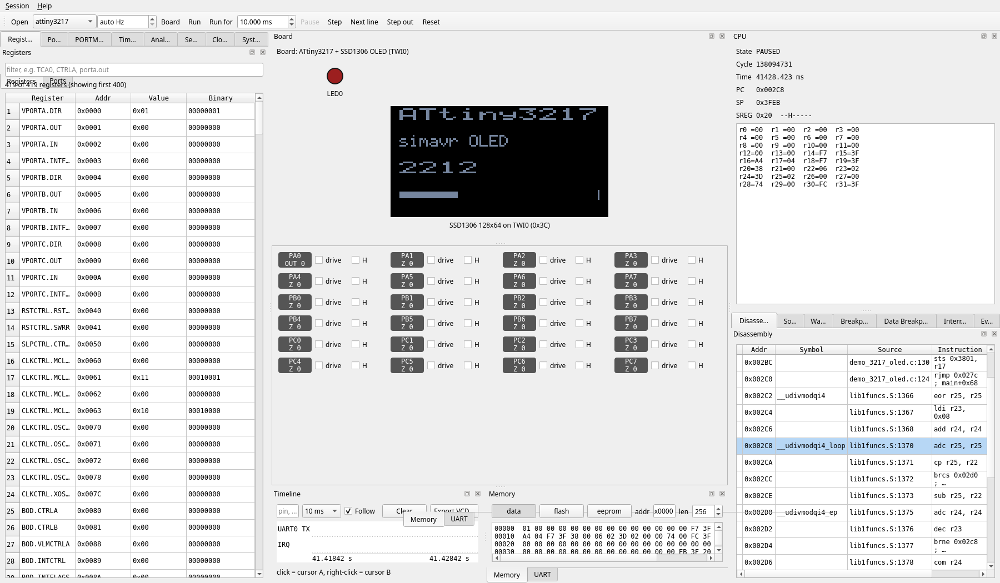

simavr - a lean and mean Atmel AVR simulator for linux
======

[](https://github.com/garyPenhook/simavr/actions/workflows/ci.yml)

> **This is a fork** that adds modern AVR (AVRxt) support — working cores for the
> **entire tinyAVR® 0-series** (11 devices), **tinyAVR® 1-series** (15 devices),
> **tinyAVR® 2-series** (12 devices) and
> **megaAVR® 0-series** (8 devices, incl. the ATmega4809). It is **not**
> the same as upstream or the distro packages;
> see [Modern AVR (AVRxt) support](#modern-avr-avrxt--tinyavr-1-series--megaavr-0-series-support--this-fork)
> below, and note that **`apt`/`brew` install upstream simavr, not this fork** — you
> must build from source (see [Installation](#installation)).

_simavr_ is an AVR simulator for linux, or any platform that uses avr-gcc. It uses 
avr-gcc's own register definition to simplify creating new targets for supported AVR
devices. The core was made to be small and compact, and hackable so allow quick 
prototyping of an AVR project. The AVR core is now stable for use with parts 
with <= 128KB flash, and with preliminary support for the bigger parts. The 
simulator loads ELF files directly, and there is even a way to specify simulation 
parameters directly in the emulated code using an .elf section. You can also 
load multipart HEX files.

```diff
- _simavr_ is provided **AS IS**. If you think you should report "security vulnerabilities"
- and waste everyones time with them, you are either a grifter OR an idiot, or both. And
- anyone checking the CV you brag about it will see this paragraph, first.
```

Modern AVR (AVRxt) / tinyAVR® 1-series + megaAVR® 0-series support — *this fork*
------------------------------------------------------------------------------

This fork adds **modern AVR (AVRxt)** cores to _simavr_: the **entire
tinyAVR® 0-series**, the **entire tinyAVR® 1-series**, the **entire tinyAVR® 2-series** and the **entire megaAVR® 0-series** (including the popular
**ATmega4809**). Every stock _simavr_ target is a classic AVRe/AVRe+ part;
the tinyAVR / megaAVR‑0 / AVR‑Dx families use the AVRxt core with a completely
different, register‑block peripheral architecture, so this needed engine work as
well as new peripheral models. The full design notes and implementation log are
in [`doc/attiny3217_design.md`](doc/attiny3217_design.md).

**Supported tinyAVR 0-series parts** (11 devices; no DAC, TCD or PTC, a single
TCB/AC/ADC — see AN2636):

| Flash | 8-pin | 14-pin | 20-pin | 24-pin |
|------:|:-----:|:------:|:------:|:------:|
| 2 KB  | ATtiny202 | ATtiny204 | — | — |
| 4 KB  | ATtiny402 | ATtiny404 | ATtiny406 | — |
| 8 KB  | — | ATtiny804 | ATtiny806 | ATtiny807 |
| 16 KB | — | ATtiny1604 | ATtiny1606 | ATtiny1607 |

**Supported 1-series parts** (15 devices, all 8/14/20/24-pin variants):

| Flash | 8-pin | 14-pin | 20-pin | 24-pin |
|------:|:-----:|:------:|:------:|:------:|
| 2 KB  | ATtiny212 | ATtiny214 | — | — |
| 4 KB  | ATtiny412 | ATtiny414 | ATtiny416 | ATtiny417 |
| 8 KB  | — | ATtiny814 | ATtiny816 | ATtiny817 |
| 16 KB | — | ATtiny1614 | ATtiny1616 | ATtiny1617 |
| 32 KB | — | ATtiny3214 | ATtiny3216 | ATtiny3217 |

**Supported 2-series parts** (12 devices; 14/20/24-pin — the 14-pin x24 parts fit
PORTA and PORTB[3:0] only, the x26/x27 parts add PORTC):

| Flash | 14-pin | 20-pin | 24-pin |
|------:|:------:|:------:|:------:|
| 4 KB  | ATtiny424  | ATtiny426  | ATtiny427  |
| 8 KB  | ATtiny824  | ATtiny826  | ATtiny827  |
| 16 KB | ATtiny1624 | ATtiny1626 | ATtiny1627 |
| 32 KB | ATtiny3224 | ATtiny3226 | ATtiny3227 |

The 2-series is a different peripheral generation, not a 1-series with moved
addresses: a **12-bit differential ADC with a 1x–16x PGA** (single, series and
burst accumulation, scaling, window comparator, event trigger), AC0 with a
**DACREF** divider and a third negative pin, a VREF that selects only the AC0
reference, **four CCL LUTs with an output-edge interrupt**, a six-channel
channel/user EVSYS, two USARTs, and no DAC or TCD0.

**Supported megaAVR 0-series parts** (8 devices):

| Flash | 28/32-pin (x08) | 40/48-pin (x09) |
|------:|:---------------:|:---------------:|
| 8 KB  | ATmega808  | ATmega809  |
| 16 KB | ATmega1608 | ATmega1609 |
| 32 KB | ATmega3208 | ATmega3209 |
| 48 KB | ATmega4808 | ATmega4809 |

Each family is driven from one shared core template
([`cores/sim_tinyx1.h`](simavr/cores/sim_tinyx1.h),
[`cores/sim_tinyx2.h`](simavr/cores/sim_tinyx2.h),
[`cores/sim_megax08.h`](simavr/cores/sim_megax08.h)) plus a per-device file; all
device specifics — memory sizes, signature, interrupt vector table, and which
peripheral instances are fitted (PORTB/PORTC by pin count and TCB1/ADC1/AC1-2 on
the larger tinyAVR; USART3/TCB3 on the 48-pin megaAVR-0) — are taken straight
from each device's avr-libc header, which is generated from the same Microchip
device files as the datasheets.

The megaAVR-0 parts model six ports (A–F), TCA0, TCB0–3, USART0–3, TWI0, SPI0,
RTC+PIT, ADC0 (with temp sensor), AC0, CCL, EVSYS, NVMCTRL (EEPROM + flash
self-programming), VREF, PORTMUX, WDT, CRCSCAN, BOD/VLM, SLPCTRL, RSTCTRL and
SYSCFG/SIGROW. TCD and DAC are not present on this family.

**AVR DD (AVR Dx family, work in progress)** — `avr32dd14` boots and runs firmware
through [`cores/sim_avrdd.h`](simavr/cores/sim_avrdd.h) with the AVR Dx clock
controller, NVM controller, signature row/fuses and multi-pin PORT configuration
modelled from DS40002413B; EVSYS, PORTMUX, VREF, ADC0, AC0, DAC0, ZCD, MVIO, TCD0
and CRCSCAN are not modelled yet. See [`doc/avr_dd_support.md`](doc/avr_dd_support.md).

**Engine — a "modern AVR" mode (the classic path is left byte‑for‑byte unchanged):**
* modern addressing model (no `0x20` I/O offset, per‑core SP/SREG, enlarged I/O map)
* AVRxt instruction timing
* Configuration Change Protection (CCP) unlock window
* the **CPUINT** interrupt controller (LVL0/LVL1/NMI, round‑robin), flash mapped
  into data space, and SLEEP gated by `SLPCTRL`

**Modern peripherals modelled for the ATtiny3217:** CLKCTRL, RSTCTRL, SLPCTRL,
PORT/VPORT + PORTMUX, TCA0, TCB0/1, TCD0 (One Ramp, Two Ramp, Four Ramp, and
Dual Slope), RTC + PIT, USART0, SPI0, TWI0,
ADC0 (incl. the temperature sensor with SIGROW calibration), AC0, DAC0, VREF,
NVMCTRL (EEPROM **and** flash self-programming; EEPROM persists across reset),
CCL, EVSYS, WDT, CRCSCAN, BOD/VLM, and SYSCFG/SIGROW device identity.

**Remaining modern-AVR backlog:** the major missing blocks are no longer
top-level peripherals but feature depth inside existing models. The current
follow-up work is:
* `AC`: hysteresis, low-power / run-standby timing, and more physical pin-level behavior
* `DAC`: output-buffer / run-standby / reference-behavior polish beyond the current digital-to-mV model
* `CCL`: the peripheral waveform sources are auto-wired into the LUT input MUX —
  AC0-2 OUT, TCD0 WOA/WOB, TCA0 WO0-2 (single-slope PWM) and TCB0-2 WO (8-bit PWM)
  track the real peripherals end-to-end. Remaining: the line-level sources
  (USART TXD/XCK, SPI SCK/MOSI/MISO — gated on the USART/SPI line-level work below),
  EVSYS EVENT0/1, and non-combinational details such as filter variants and sequencer corner cases
* `SPI`: any remaining pin-contention / electrical-behavior realism beyond the buffered protocol model
* `USART`: more exact one-wire / line-level behavior; sync timing is implemented
* `TCB`: the Single-Shot waveform output is not yet modelled (8-bit PWM is); it needs an event-triggered
  one-shot counter path. TCA0 is complete: all WGMODEs (FRQ, single- and dual-slope), double-buffered
  PER/CMPn, CTRLE/CTRLF commands, up/down event counting and split mode
* robustness / fidelity follow-ups:
  `TCB` first-period scheduling when enabled with non-zero `CNT`,
  `CCL` filter/edge timer callback cost when left running on static inputs,
  shared `tick_ctx` typing in `avr_ccl`,
  a clarifying comment on the manual SPI interrupt raise/clear path,
  and a datasheet pass over the EVSYS generator source encodings currently used in the core templates

It loads ordinary `avr-gcc -mmcu=attiny3217` ELF files. A blink, end to end:

```c
#include <avr/io.h>
int main(void) {
    PORTA.DIRSET = PIN0_bm;          // PA0 = output
    for (;;) {
        PORTA.OUTTGL = PIN0_bm;      // toggle the LED on PA0
        for (volatile uint16_t i = 0; i < 300; i++) ;   // delay
    }
}
```

```sh
avr-gcc -mmcu=attiny3217 -Os -o blink.elf blink.c
# run it and trace PA0 to a VCD you can open in GTKWave:
simavr/run_avr -m attiny3217 -f 3333333 \
    --add-trace 'PA0=portpin@0x0/0x41' -o blink.vcd blink.elf
```

The modern engine and every peripheral above are covered by
`tests/test_avrxt_engine.c` (380 self‑checks); run the suite with
`make -C tests run_tests`.

**Modern-AVR example boards.** Three runnable examples under
[`examples/`](examples) demonstrate the modern engine end to end (every other
board in that directory targets a classic AVR):

* [`board_atmega4809`](examples/board_atmega4809) — megaAVR-0 blink + USART0,
  driving the real pins via the modern PORT and PORTMUX models.
* [`board_attiny3217`](examples/board_attiny3217) — the tinyAVR-1 sibling, same
  structure on the other modern family.
* [`board_modern_avr`](examples/board_modern_avr) — a **coverage** board: one
  device-agnostic firmware is built for *every* supported modern core (all 11
  tinyAVR 0-series + 15 tinyAVR 1-series + 12 tinyAVR 2-series + 8 megaAVR-0) and the host runner boots each and checks that
  seven core peripherals respond — PORT, TCA0, TCB0, RTC, ADC0, SPI0 and TWI0
  (plus USART0 as the result transport). `make run` reports `46/46 cores PASSED`.

Each board's Makefile gates the firmware build on a modern `avr-gcc` (12+), so a
plain `make` across `examples/` still succeeds on older toolchains.

**Host API for GUIs and bindings (draft).**
[`simavr/sim/sim_host.h`](simavr/sim/sim_host.h) is a plain-C embedding API
that keeps `avr_t` internals out of the interface: opaque handles, a
library-owned simulation thread with run/pause/step/run-for-N-cycles and a
real-time throttle, breakpoints, memory and CPU access, pins by name (`"PA3"`)
with external drive, USART send/receive, and a bounded event queue with a
pollable fd (for `QSocketNotifier`/`select`) instead of foreign-thread
callbacks. It is the Phase 1 boundary for the planned Python GUI
([`doc/python_gui_todo.md`](doc/python_gui_todo.md)) and is **not ABI-stable
yet** (`AVR_HOST_API_VERSION` 0). Register metadata, symbols, watchpoints,
analog input, interrupt events and VCD return `AVR_HOST_ENOTSUP` for now.
[`tests/test_sim_host.c`](tests/test_sim_host.c) is a host-only test
(no `avr-gcc`); build instructions are in its header. Python bindings
(cffi, Python 3.15, free-threading capable) live in [`python/`](python).

**Desktop GUI.** [`python/`](python) also holds a PySide6 front-end (`./simavr-gui`) for
loading firmware, running, stepping and poking pins, with register, port, timer, analog, serial,
clock, system, interrupt and timeline docks and virtual board parts (LEDs, buttons, LCD, SSD1306
OLED). It works on the modern AVRs and on classic parts such as the ATtiny13A. Below it runs an
ATtiny3217 driving an SSD1306 OLED over TWI0
([`python/examples/demo_3217_oled.c`](python/examples/demo_3217_oled.c)); see the
[GUI README](python/README.md) for the full dock list.



Installation
------------

> ⚠️ **To use this fork's ATtiny3217 / modern-AVR support, build from source from
> this repository.** The package-manager options below (`apt`, Homebrew, the Ubuntu
> package) install **upstream** simavr, which does **not** contain any of the
> modern-AVR work described above — installing those will *not* give you the
> ATtiny3217 core.
>
> ```sh
> git clone https://github.com/garyPenhook/simavr
> cd simavr
> make                         # builds the library and simavr/run_avr
> # optional, system-wide:  sudo make install RELEASE=1
> # quick check (lists the new modern-AVR cores):
> #   simavr/run_avr --list-cores | tr ' ' '\n' | grep -E 'attiny(212|412|214|414|814|1614|3214|416|816|1616|3216|417|817|1617|3217)|atmega(808|809|1608|1609|3208|3209|4808|4809)'
> ```
>
> You'll also need a **modern `avr-gcc`** (one that supports `-mmcu=attiny3217`,
> e.g. avr-gcc 12+) to *compile* ATtiny3217 firmware; older packaged `gcc-avr`
> toolchains can't target it. simavr itself builds with a plain host compiler.

The upstream installation options below remain valid for stock simavr (classic
AVR parts only):

On OSX, we recommend using [homebrew](https://brew.sh):

    brew tap osx-cross/avr
    brew install --HEAD simavr

On Ubuntu, SimAVR is available in the Bionic package source:

    apt-get install simavr

(Note that the command is made available under the name `simavr` not `run_avr`.)

Otherwise, `make` is enough to just start using __bin/simavr__. To install the __simavr__ command system-wide, `make install RELEASE=1`.

Supported IOs
--------------
* _eeprom_
* _watchdog_
* _IO ports_ (including pin interrupts)
* _Timers_, 8 &16 (Normal, CTC and Fast PWM, the overflow interrupt too)
* The _UART_, including tx & rx interrupts (there is a loopback/local echo test mode too)
* _SPI_, master/slave including the interrupt
* _i2c_ Master & Slave
* External _Interrupts_, INT0 and so on.
* _ADC_
* Self-programming (ie bootloaders!)
* A lot more!

Emulated Cores (very easy to add new ones!)
--------------

**Modern AVR (AVRxt) — *this fork*:**
+ tinyAVR® 0-series: ATtiny202 / 402 (8-pin); 204 / 404 / 804 / 1604 (14-pin); 406 / 806 / 1606 (20-pin); 807 / 1607 (24-pin)
+ tinyAVR® 1-series: ATtiny212 / 412 (8-pin); 214 / 414 / 814 / 1614 / 3214 (14-pin); 416 / 816 / 1616 / 3216 (20-pin); 417 / 817 / 1617 / 3217 (24-pin)
+ tinyAVR® 2-series: ATtiny424 / 824 / 1624 / 3224 (14-pin); 426 / 826 / 1626 / 3226 (20-pin); 427 / 827 / 1627 / 3227 (24-pin)
+ megaAVR® 0-series: ATmega808 / 1608 / 3208 / 4808 (28/32-pin); ATmega809 / 1609 / 3209 / 4809 (40/48-pin)
+ see [Modern AVR (AVRxt) support](#modern-avr-avrxt--tinyavr-1-series--megaavr-0-series-support--this-fork)

**Classic AVR (AVRe/AVRe+):**
+ ATMega2560
+ AT90USB162 (with USB!)
+ ATMega1281
+ ATMega1280
+ ATMega128
+ ATMega128rf1
+ ATMega16M1
+ ATMega169
+ ATMega162
+ ATMega164/324/644
+ ATMega48/88/168/328
+ ATMega8/16/32
+ ATTiny25/45/85
+ ATTIny44/84
+ ATTiny2313/2313v
+ ATTiny13/13a (audited against DS40002307A, see [doc/attiny13a_audit.md](doc/attiny13a_audit.md))
+ Many more!

Extras:
-------
* fully working _gdb_ support including some pretty cool “passive modes”.
* There is also very easy support for “VCD” (Value Change Dump) that can be visualized 
graphically as “waveforms” with tools like _gtkwave_ (see below).
* You can even source your own VCD files (for example from your logic analyzer) and feed them into your simulation.
* There are a few examples of real life firmwares running on simavr, including OpenGL rendering of the display…
* There is support for _Arduino_, but no IDE integration

Documentation And Further Information
-------------------------------------

* [Introduction](https://htmlpreview.github.io/?https://raw.githubusercontent.com/buserror/simavr/refs/heads/master/doc/Intro.html)
* [Manual / Developer Guide](doc/manual/manual.pdf?raw=true)
* [Examples](examples)
* [Mailing List](https://groups.google.com/g/simavr)
* IRC: _#simavr_ on Libera Chat

Contributing
------------

Patches are always welcome! Please submit your changes via Github pull requests.

VCD Support -- built in logic analyzer 
-----------
_simavr_ can output most of its pins, firmware variables, interrupts and a few other
things as signals to be dumped into a file that can be plotted using gtkwave for
further, precise analysis.
A firmware can contain instructions for _simavr_ to know what to trace, and the file is
automatically generated.
Example:

	const struct avr_mmcu_vcd_trace_t _mytrace[]  _MMCU_ = {
		{ AVR_MCU_VCD_SYMBOL("UDR0"), .what = (void*)&UDR0, },
		{ AVR_MCU_VCD_SYMBOL("UDRE0"), .mask = (1 << UDRE0), .what = (void*)&UCSR0A, },
	};

Will tell _simavr_ to generate a trace everytime the UDR0 register changes and everytime
the interrupt is raised (in UCSR0A). The *_MMCU_* tag tells gcc that it needs compiling,
but it won't be linked in your program, so it takes literally zero bytes, this is a code
section that is private to _simavr_, it's free!
A program running with these instructions and writing to the serial port will generate
a file that will display:

	$ ./simavr/run_avr tests/atmega88_example.axf
	AVR_MMCU_TAG_VCD_TRACE 00c6:00 - UDR0
	AVR_MMCU_TAG_VCD_TRACE 00c0:20 - UDRE0
	Loaded 1780 .text
	Loaded 114 .data
	Loaded 4 .eeprom
	Starting atmega88 - flashend 1fff ramend 04ff e2end 01ff
	atmega88 init
	avr_eeprom_ioctl: AVR_IOCTL_EEPROM_SET Loaded 4 at offset 0
	Creating VCD trace file 'gtkwave_trace.vcd'
	Read from eeprom 0xdeadbeef -- should be 0xdeadbeef..
	Read from eeprom 0xcafef00d -- should be 0xcafef00d..
	simavr: sleeping with interrupts off, quitting gracefully

And when the file is loaded in gtkwave, you see:


You get a very precise timing breakdown of any change that you add to the trace, down
to the AVR cycle. 

Example:
--------
_simavr_ is really made to be the center for emulating your own AVR projects, not just
a debugger, but also the emulating the peripherals you will use in your firmware, so 
you can test and develop offline, and now and then try it on the hardware.

You can also use _simavr_ to do test units on your shipping firmware to validate it
before you ship a new version, to prevent regressions or mistakes.

_simavr_ has a few 'complete projects/ that demonstrate this, most of them were made
using real hardware at some point, and the firmware binary is _exactly_ the one that
ran on the hardware. The key here is to emulate the _parts_ or peripherals that
are hooked to the AVR. Of course, you don't have to emulate the full hardware, you just
need to generate the proper stimulus so that the AVR is fooled.

HD44780 LCD Board Demo
----------------------


This example board hooks up an Atmega48 to an emulated HD44780 LCD and display a running
counter in the 'lcd'. Everything is emulated, the firmware runs exactly like this
on a real hardware.


And this is a gtkwave trace of what the firmware is doing. You can zoom in, measure, etc
in gtkwave, select traces to see etc.

Quite a few other examples are available!
